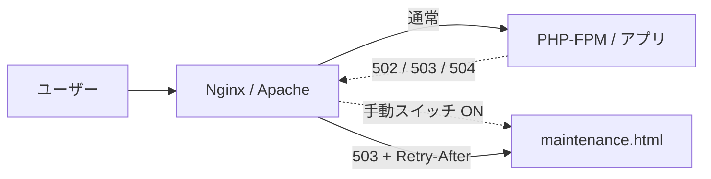
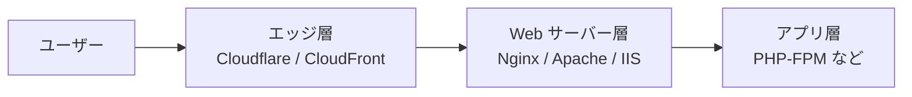
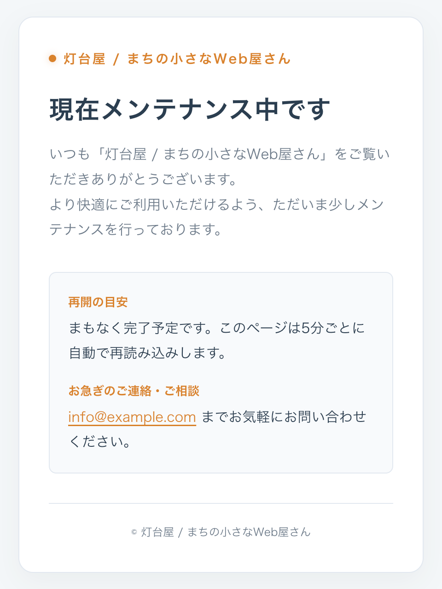
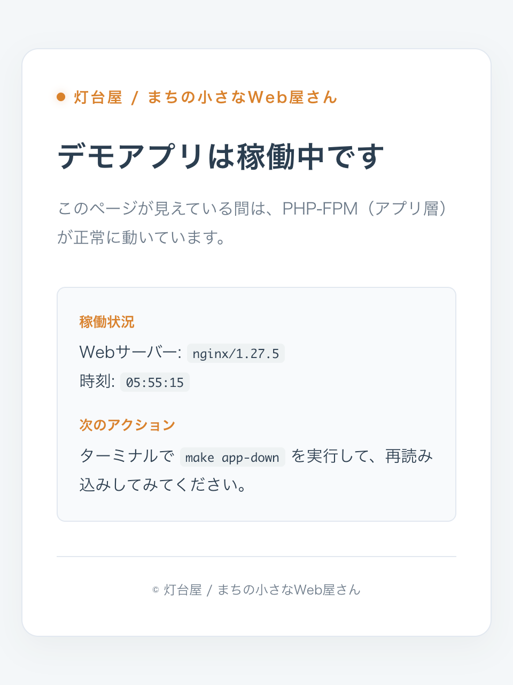
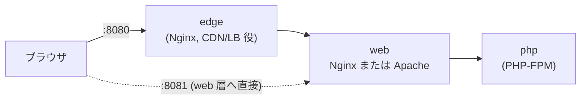

# メンテナンステンプレート

アプリが落ちていても、ブランドを損なわずに止まれるサイトにする。
Nginx / Apache の設定と静的 HTML 1 枚だけで導入できる、メンテナンスモードのテンプレートです。

> **このリポジトリについて**  
> ポートフォリオ用のプロジェクトです。「灯台屋」は実在しない店舗であり、  
> `info@example.com` や `203.0.113.10` はドキュメント用のダミー値です。

---

## 背景

PHP をはじめとするアプリケーションの脆弱性が見つかった際、最優先事項は「まず安全に止める」ことです。
しかし、緊急停止の現場では次のようなトラブルが発生しがちです。

- ブラウザに黒い画面や接続エラーが表示される
- Nginx / Apache の味気ないデフォルトエラー画面が出る
- 何が起きているのか、いつ復旧するのかが利用者に伝わらない

これではブランドイメージや利用者の信頼を損ねてしまいます。
さらに、検索エンジンに「サイトが破損している」と誤解され、SEO 上のリスクが生じる可能性もあります。

## 解決策

**アプリ層が完全にクラッシュしていても、Web サーバー層がそれを検知し、静的 HTML のメンテナンス画面へ即座にフォールバックします。**



動作のトリガーは 2 つあります。

| きっかけ               | 仕組み                        | 想定シーン                               |
| ---------------------- | ----------------------------- | ---------------------------------------- |
| **手動スイッチ**       | フラグファイルを配置 / 削除   | 脆弱性対応、計画メンテナンス             |
| **自動フォールバック** | 上流の 502 / 503 / 504 を検知 | PHP-FPM 停止、過負荷、想定外のクラッシュ |

メンテナンス画面は完全な静的 HTML であるため、PHP・DB・アプリには一切依存しません。
アプリ層が全滅していても確実に表示可能です。

## このリポジトリのメリット

| 担当                               | 役割                             | 対象ファイル              |
| ---------------------------------- | -------------------------------- | ------------------------- |
| デザイナー / フロントエンジニア    | 画面デザインの調整               | `public/maintenance.html` |
| インフラ担当（兼任エンジニア含む） | 設定のコピー＆パラメータ書き換え | `config/*.sample`         |

役割が明確に分離されているため、デザイン変更によってサーバー設定が破損する心配はありません。
また、インフラ設定者が HTML を解読・編集する必要もありません。

## 構成

```
my-maintenance-template/
├── README.md
├── docker-compose.yml             # 各層の切り替えを検証できるデモ環境
├── Makefile                       # 障害再現・操作用コマンド集
├── public/
│   └── maintenance.html           # 外部依存ゼロの静的メンテナンス画面
├── config/
│   ├── nginx.conf.sample          # Nginx 用設定
│   ├── htaccess.sample            # Apache 用設定
│   ├── web.config.sample          # IIS 用設定
│   └── edge/                      # 前段（CDN / LB）層用設定
│       ├── cloudflare-worker.js.sample   # Cloudflare Workers（手動 + 自動）
│       └── cloudfront.tf.sample          # AWS CloudFront + S3（自動）
├── docker/                        # デモ環境用コンテナ設定（edge / nginx / apache / app）
└── state/                         # デモ用フラグ配置ディレクトリ（maintenance.flag）
```

### 多層防御の考え方

障害の発生ポイントによって、メンテナンス画面を返却できる層が異なります。
本リポジトリでは、各層に応じた設定を用意しています。



| 障害ポイント                | 対応する層     | 使用する設定ファイル                                          |
| --------------------------- | -------------- | ------------------------------------------------------------- |
| アプリ（PHP-FPM など）      | Web サーバー層 | `nginx.conf.sample` / `htaccess.sample` / `web.config.sample` |
| Web サーバー / サーバー全体 | エッジ層       | `config/edge/`                                                |

構成は環境に応じて選択できます。
最小構成であれば Web サーバー層のみ、冗長性を高める場合はエッジ層も併用します。

## 設計上のこだわり

### 1. HTTP ステータスは必ず 503 を返却

メンテナンス画面を `200 OK` で返すと、検索エンジンが一時的な画面をインデックスしてしまいます。
`503 Service Unavailable` と `Retry-After` を返すことで、「一時的な停止であり、後ほど再訪問してほしい」旨を正しく伝えます。
自動フォールバック発生時（502 / 504 検知時）も、Nginx の `=503` 指定等によりクライアントへは 503 で統一します。

### 2. メンテ画面は「1 ファイル・外部依存ゼロ」

外部 CSS、JS、画像、Web フォントへの依存を一切排除しています。
メンテナンス中は CDN や別ドメインが利用できない可能性を考慮し、HTML 1 枚で完結する設計にしています。
フォントも OS 標準フォントを指定し、表示崩れを防ぎます。

### 3. キャッシュさせない設定

`Cache-Control: no-store` を付与しています。
サービス復旧後もブラウザや CDN にメンテナンス画面がキャッシュされ続ける事故を防止します。

### 4. 保守担当者用の迂回ルート（IP 制限）

特定の許可 IP アドレスからは、メンテナンス中であっても通常サイトへアクセス可能です。
公開前の動作確認や復旧検証を安全に行えます。

### 5. Web サーバー再起動なしで即時切り替え

リクエストごとにフラグファイルの有無を確認しています。
`touch` と `rm` のコマンド操作のみで切り替わり、サーバーの reload や restart は不要です。
緊急時のオペレーションミスを減らすための設計です。

## デモ環境（Docker）



各層での挙動をローカル環境で再現・検証できます。



### 起動手順

```bash
make up WEB=nginx      # Nginx 構成で起動
make up WEB=apache     # Apache 構成で起動（Nginx 構成を停止してから実行）
make down              # 停止
```

※ `make` が利用できない環境では、`docker compose --profile nginx up -d`（Apache の場合は `--profile apache`）で起動可能です。  
ブラウザから `http://localhost:8080`（エッジ経由）および `http://localhost:8081`（Web 層直通）へアクセスします。

### 障害再現コマンド

```bash
make app-down     # アプリ層（PHP-FPM）を停止       (復旧: make app-up)
make web-down     # Web サーバー層を停止            (復旧: make web-up WEB=nginx)
make flag-on      # 手動メンテナンス ON             (解除: make flag-off)
make status       # ステータスと返却層（X-Maintenance-Layer）の確認
```

### 期待される応答挙動

`X-Maintenance-Layer` レスポンスヘッダーにより、どの層がレスポンスを返したか確認できます。

**Nginx 構成時**

| 操作       | :8081（Web 層直通） | :8080（エッジ経由） |
| ---------- | ------------------- | ------------------- |
| 通常時     | 200                 | 200                 |
| `flag-on`  | 503 (web-nginx)     | 503 (web-nginx)     |
| `app-down` | 503 (web-nginx)     | 503 (web-nginx)     |
| `web-down` | 接続不可            | 503 (edge)          |

**Apache 構成時**

| 操作       | :8081（Web 層直通）  | :8080（エッジ経由） |
| ---------- | -------------------- | ------------------- |
| 通常時     | 200                  | 200                 |
| `flag-on`  | 503 (web-apache)     | 503 (web-apache)    |
| `app-down` | **502** (web-apache) | 503 (edge)          |
| `web-down` | 接続不可             | 503 (edge)          |

※ Apache 単体では `app-down` 時に 502 ステータスで返却されます（`ErrorDocument` 仕様による）。エッジ層（edge）がこれを検知して 503 に変換して返却します。多層防御の有用性を示す具体例です。

### 検証状況と制約

- **検証済み構成**: Nginx 1.24 / Apache 2.4.58（ローカル環境）にて、本設定における上記テーブル通りの挙動を確認済みです。
- **IIS について**: Windows 専用のためデモ環境には含まれません。`web.config.sample` を参照用として提供しています。
- **エッジ層の模擬について**: デモ環境の `edge` は Nginx を用いて Cloudflare/CloudFront の挙動をキャッチアップ・再現しています。

## 導入手順

### Nginx

```bash
# 1. リポジトリの配置
sudo git clone <repo-url> /var/www/my-maintenance-template

# 2. 設定ファイルのコピーと書き換え（★箇所）
sudo cp config/nginx.conf.sample /etc/nginx/conf.d/example.com.conf
sudo vi /etc/nginx/conf.d/example.com.conf

# 3. 構文チェックと反映
sudo nginx -t && sudo systemctl reload nginx
```

### Apache

```bash
# 1. メンテナンス画面をドキュメントルートに配置
cp public/maintenance.html /var/www/example.com/public/

# 2. .htaccess としてコピー（または vhost に設定追記）
cp config/htaccess.sample /var/www/example.com/public/.htaccess

# 3. 必要モジュールの有効化と反映
sudo a2enmod rewrite headers && sudo systemctl reload apache2
```

### IIS

```powershell
# 1. URL Rewrite モジュールをインストール（未導入の場合）
# 2. メンテ画面と設定をサイトルートに配置
Copy-Item public\maintenance.html C:\inetpub\wwwroot\
Copy-Item config\web.config.sample C:\inetpub\wwwroot\web.config   # 既存ファイルがある場合はマージ

# 3. フラグパス（C:\inetpub\maintenance.flag）および IP 制限設定の変更
```

### エッジ層（CDN / LB）

- **Cloudflare**: `config/edge/cloudflare-worker.js.sample` および末尾の `wrangler.toml` 例を参考に Worker をデプロイします。
- **AWS CloudFront**: `config/edge/cloudfront.tf.sample` を Terraform 等で適用し、`origin_domain` などを環境に合わせて変更します。

## Docker 環境での運用

本テンプレートを自身の `docker-compose.yml` に組み込む場合の手順（Nginx 例）です。

### 設定例（Nginx）

1. `config/nginx.conf.sample` をプロジェクトへコピーし、下記を調整します。
   - `root`: アプリのルートパス
   - `fastcgi_pass`: `php:9000` などのコンテナサービス名
   - `@maintenance` 内の `root`: 下記マウント先（例: `/usr/share/nginx/maintenance`）
2. `docker-compose.yml` にマウント設定を追加します。

```yaml
services:
  web:
    image: nginx:1.27-alpine
    ports: ["80:80"]
    volumes:
      - ./nginx/default.conf:/etc/nginx/conf.d/default.conf:ro
      - ./my-maintenance-template/public:/usr/share/nginx/maintenance:ro
      - ./state:/var/www:ro # maintenance.flag の配置場所
    restart: unless-stopped
```

3. 構文確認後、コンテナを起動・反映します。

### 本番運用時の推奨事項

- **Web 層ポートの不必要な公開を回避**: 外部公開するのは最前段のエッジ層または LB のみに限定してください。
- **`X-Maintenance-Layer` ヘッダーの除去**: 内部構成の露呈を防ぐため、本番環境ではこのヘッダー出力を削除することを推奨します。
- **フラグ置き場の読み取り専用マウント**: コンテナからの改ざんを防ぐため、`:ro`（Read Only）でマウントします。

## 運用方法（直接サーバーに導入する場合）

```bash
# メンテナンスモード ON
sudo touch /var/www/maintenance.flag

# メンテナンスモード OFF
sudo rm /var/www/maintenance.flag
```

- IIS の場合: `New-Item C:\inetpub\maintenance.flag -ItemType File` / `Remove-Item C:\inetpub\maintenance.flag`
- Cloudflare の場合: KV のフラグ値変更で切り替え

## 動作確認コマンド例

```bash
# 手動切り替えの確認
sudo touch /var/www/maintenance.flag
curl -I http://example.com/
# -> HTTP/1.1 503 Service Unavailable
# -> Retry-After: 3600
# -> Cache-Control: no-store

# 自動フォールバックの確認（アプリ停止時）
sudo rm /var/www/maintenance.flag
sudo systemctl stop php8.3-fpm
curl -I http://example.com/index.php
# -> HTTP/1.1 503 Service Unavailable

sudo systemctl start php8.3-fpm
```

## 制約事項・注意点

- **タイムアウト時間について**: PHP-FPM プロセス自体が停止・消滅している場合は即座に 502/503 が返りますが、プロセスがハングアップしている場合は `fastcgi_read_timeout` 等で設定した秒数待機した後にフォールバックします。
- **Web サーバー自体の停止**: Nginx / Apache 自体がダウンした場合は Web サーバー単体で画面を返せません。前段のエッジ層（Cloudflare / CloudFront 等）でカバーする必要があります。
- **500 Internal Server Error について**: アプリケーション側の通常の例外画面等を誤って覆い隠さないよう、デフォルトでは 500 エラーを拾わない設定にしています。必要に応じて設定を解除してください。

## ライセンス

MIT
